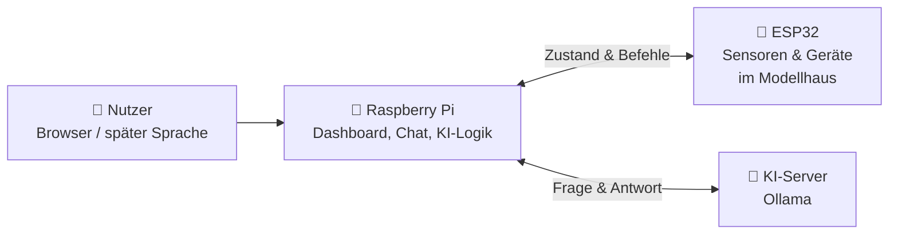

# 🏠 Hausmesse – Smarthome mit KI-Sprachassistent

Ein Modellhaus, mit dem man **in normalen Sätzen reden** kann.
Sag „Mir ist kalt“, und das Haus prüft die Temperatur, dreht die Heizung auf und erinnert dich daran, dass im Wohnzimmer noch das Fenster offen ist.

Bedient wird das Haus über ein **Web-Dashboard** mit animiertem Modellhaus, einen **Text-Chat** und später auch per **Sprache** wie bei Alexa.

---

## Aufbau



| Teil | Aufgabe |
|---|---|
| **ESP32** | Liest die Sensoren, schaltet Licht, Heizung, Klimaanlage, Lüfter und Garagentor und regelt die Temperatur selbstständig. |
| **Raspberry Pi** | Das „Gehirn“: stellt das Dashboard bereit, nimmt Anfragen an, fragt die KI und prüft jeden Befehl, bevor er ans Haus geht. |
| **KI-Server** | Ein Sprachmodell über [Ollama](https://ollama.com), das die Sätze versteht und entscheidet, was passieren soll. |

---

## Was das Haus kann

| | Gerät | Im Modell |
|---|---|---|
| 💡 | Licht in 5 Räumen, dimmbar | LEDs |
| 🔥 | Heizung (heizt) | rote LED |
| ❄️ | Klimaanlage (kühlt) | blaue LED |
| 🌀 | Lüfter | grüne LED |
| 🚗 | Garagentor mit Warnsignal | Servo + Buzzer, auch per IR-Fernbedienung |
| 🌡️ | Temperatur & Luftfeuchte | DHT11 |
| 🌱 | Bodenfeuchte der Pflanze | Bodenfeuchtesensor |
| 🪟 | Fenster offen / zu | Reed-Kontakte (vorerst simuliert) |

**Zum Beispiel:**

> 👤 *Ich gehe jetzt schlafen.*
>
> 🏠 *Gute Nacht! Ich habe alle Lichter ausgeschaltet, das Schlafzimmer gedimmt und die Heizung auf 18 Grad gestellt. Kurze Erinnerung: Das Fenster im Wohnzimmer ist noch offen, und das Garagentor auch. Soll ich das Garagentor schließen?*
>
> 👤 *Ja.*
>
> 🏠 *Alles klar, ich schließe das Garagentor.*

Allgemeine Fragen wie „Wie hoch ist der Mount Everest?“ beantwortet das Haus ebenfalls.

---

## KI und Code arbeiten zusammen

Die KI versteht, **was** gemeint ist. Fester Code sorgt dafür, dass es **zuverlässig** passiert: Er prüft jeden Befehl, führt Szenen wie „Gute Nacht“ immer vollständig aus und erkennt offene Fenster und Tore selbst. So kombiniert das Haus das Sprachverständnis der KI mit der Verlässlichkeit normaler Programmierung.

---

## Projektstruktur

```
Hausmesse/
├── src/main.cpp      # ESP32: Sensoren, Geräte, Temperaturregelung
├── platformio.ini    # PlatformIO-Konfiguration
├── Pi/               # Raspberry Pi
│   ├── app.py        # Webserver für Dashboard und Chat
│   ├── ki.py         # KI-Logik, Szenen, Befehlsprüfung
│   ├── voice.py      # Wakeword, Aufnahme, Gesprächsablauf
│   ├── stt.py        # Spracherkennung (schickt Aufnahme an den Server)
│   ├── tts.py        # Sprachausgabe mit Piper
│   ├── config.py     # Einstellungen
│   └── static/       # Dashboard mit dem Modellhaus
└── server/
    └── stt_server.py # Spracherkennung mit Whisper auf dem KI-Server
```

---

## Technik

**Hardware:** ESP32 · Raspberry Pi 4 · DHT11 · Bodenfeuchtesensor · Servo · Buzzer · IR-Empfänger · LEDs
**Software:** C++ (Arduino / PlatformIO) · Python (Flask) · Ollama · Whisper · Piper · openWakeWord · HTML/SVG/JavaScript

---

## Stand

- [x] Modellhaus mit Sensoren, Licht, Heizung, Klimaanlage und Garagentor
- [x] Web-Dashboard mit Live-Modellhaus und manueller Steuerung
- [x] KI-Chat mit Szenen, Erinnerungen und Rückfragen
- [x] Sprachausgabe
- [x] Spracherkennung mit Wakeword
- [ ] Echte Fensterkontakte
- [ ] Anbindung an den KI-Server der Firma
